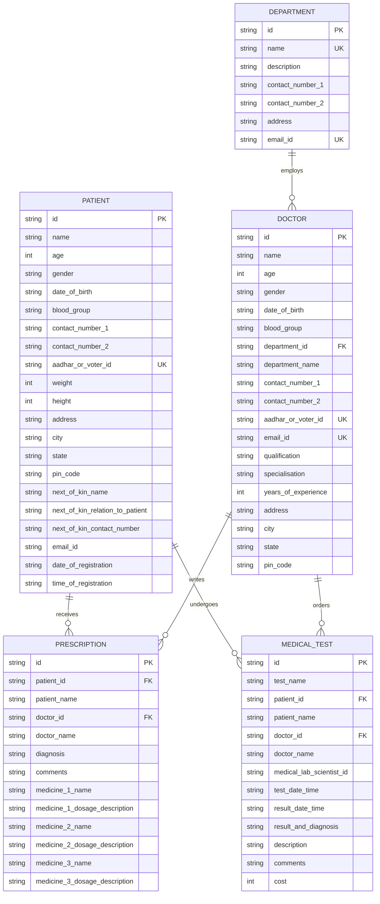

# Health Management System Using Python 🏥

[](https://www.python.org/)
[](https://streamlit.io/)
[](https://www.sqlite.org/)
[](https://pandas.pydata.org/)
[](https://opensource.org/licenses/MIT)

A modern, interactive **Healthcare Information Management System (HIMS)** built in Python with **Streamlit** and **SQLite3**. Designed for hospitals, clinics, and medical centers to streamline patient administration, doctor directory allocations, multi-drug prescription management, laboratory medical diagnostics, and departmental coordination—all secured through a tiered, role-based access model.

---

## 📑 Table of Contents

- [Overview](#-overview)
- [Key Features](#-key-features)
- [Multi-Tier Security & Access Control](#-multi-tier-security--access-control)
- [System Architecture](#-system-architecture)
- [Database Schema & Relational Model](#-database-schema--relational-model)
- [Project Directory Structure](#-project-directory-structure)
- [Getting Started](#-getting-started)
  - [Prerequisites](#prerequisites)
  - [Installation & Setup](#installation--setup)
  - [Configuration](#configuration)
  - [Running the Application](#running-the-application)
- [Default Demo Credentials](#-default-demo-credentials)
- [Application Modules Walkthrough](#-application-modules-walkthrough)
- [Contributing](#-contributing)
- [License](#-license)

---

## 🌟 Overview

The **Health Management System (HIMS)** provides healthcare staff, administrative personnel, and clinicians with a clean, web-based dashboard to manage healthcare workflows with data integrity and ease.

- **Offline-First & Self-Contained:** Built on SQLite3 without demanding complex external database server setups.
- **Relational Integrity Enforced:** Fully enforces foreign key constraints (`PRAGMA foreign_keys = ON`), cascading updates, and restricted deletions to prevent orphan records.
- **Clean Interactive UI:** Powered by Streamlit with real-time feedback, tabular search, and responsive dataframes.
- **Audit-Ready Identifiers:** Generates chronological, timestamped IDs for patients, doctors, prescriptions, and lab tests automatically.

---

## ✨ Key Features

### 👤 1. Patient Administration
- **Automated ID Generation:** Instant formatted identifiers (`P-<timestamp>-<date>`).
- **Comprehensive Demographic Profile:** Tracks full name, DOB, auto-calculated age, blood group, dual contact numbers, government identification (Aadhar / Voter ID), physical vitals (weight, height), and residential address.
- **Emergency Next-of-Kin Contact:** Records next-of-kin full name, relationship, and contact numbers for critical communication.
- **Flexible Search & Export:** View individual patient dossiers or tabular summaries of all registered patients.

### 🩺 2. Doctor Directory & Department Mapping
- **Staff Credentials:** Captures qualifications, clinical specializations, years of active practice, and national credentials.
- **Department Association:** Linked directly to registered hospital departments via foreign keys.
- **Integrity Guards:** Restricts deletion of doctors who have active patient prescriptions or assigned lab orders.

### 🏢 3. Department Coordination
- **Facility Divisions:** Organize clinical units (e.g., Cardiology, Neurology, Pediatrics, Radiology).
- **Staff Mapping:** Real-time query to list all practicing doctors assigned to a specific department.

### 💊 4. Clinical Prescription Management
- **Clinical Details:** Primary diagnosis documentation and physician clinical notes.
- **Multi-Medication Regimen:** Multi-slot prescription logging (up to 3 distinct medications with detailed dosage descriptions per entry).
- **Patient History:** Filter and view all past prescriptions formulated for any specific patient.

### 🔬 5. Medical Tests & Laboratory Diagnostics
- **Laboratory Records:** Logs test names, scheduled test time, lab technician / Medical Lab Scientist (MLS) IDs, and result timestamps.
- **Clinical Diagnoses & Outcomes:** Records findings, test remarks, and service costs.
- **Patient Test History:** Instant retrieval of all laboratory diagnostics conducted for a patient.

---

## 🔐 Multi-Tier Security & Access Control

To protect sensitive patient health information (PHI) and clinical records, the system enforces a 3-layer authorization hierarchy:

```
┌────────────────────────────────────────────────────────┐
│               1. System Access Layer                   │
│   (General password authentication to access the portal)│
└───────────────────────────┬────────────────────────────┘
                            │
            ┌───────────────┴───────────────┐
            ▼                               ▼
┌───────────────────────────────┐ ┌───────────────────────────────┐
│     2. Admin / Edit Mode      │ │   3. Clinical / MLS Access    │
│  Patient, Doctor, Department  │ │   Prescriptions & Lab Tests   │
│   (Add / Update / Delete)     │ │    (Add / Update / Delete)    │
└───────────────────────────────┘ └───────────────────────────────┘
```

| Layer | Protected Operations | Access Credential |
| :--- | :--- | :--- |
| **System Entry** | Access main application & search views | `config.password` |
| **Edit Mode** | Add, Update, or Delete Patients, Doctors, & Departments | `config.edit_mode_password` |
| **Doctor / MLS Code** | Create, Update, or Delete Prescriptions & Medical Tests | `config.dr_mls_access_code` |

---

## 🏗️ System Architecture

```
                  ┌───────────────────────────────┐
                  │      Streamlit Web Client     │
                  │        (hims_app.py)          │
                  └───────────────┬───────────────┘
                                  │
    ┌──────────────┬──────────────┼──────────────┬──────────────┐
    ▼              ▼              ▼              ▼              ▼
┌────────────┐ ┌────────────┐ ┌────────────┐ ┌────────────┐ ┌────────────┐
│ patient.py │ │ doctor.py  │ │ dept.py    │ │ presc.py   │ │ test.py    │
└─────┬──────┘ └─────┬──────┘ └─────┬──────┘ └─────┬──────┘ └─────┬──────┘
      │              │              │              │              │
      └──────────────┴───────┬──────┴──────────────┴──────────────┘
                             │
                  ┌──────────▼──────────┐
                  │     database.py     │
                  │  (SQLite3 Connector)│
                  └──────────┬──────────┘
                             ▼
                  ┌─────────────────────┐
                  │   database_1A.db    │
                  │ (Relational Storage)│
                  └─────────────────────┘
```

---

## 🗄️ Database Schema & Relational Model

The relational database architecture is defined with enforced foreign keys:



---

## 📁 Project Directory Structure

```text
├── config.py             # System credentials and database name configuration
├── database.py           # Database connection, schemas, and table initializations
├── department.py         # Department CRUD operations and department-doctor queries
├── doctor.py             # Doctor CRUD operations, verification, and formatting
├── hims_app.py           # Main Streamlit dashboard application & navigation logic
├── medical_test.py       # Laboratory diagnostics and test orders management
├── patient.py            # Patient record management and search modules
├── prescription.py       # Prescription management, multi-drug regimens, and history
├── requirements.txt      # Python dependencies (Streamlit, Pandas)
├── .gitignore            # Git exclusion rules
└── README.md             # Project documentation
```

---

## 🚀 Getting Started

### Prerequisites

Ensure you have **Python 3.8** or higher installed on your system. You can verify your version by running:

```bash
python --version
# or
python3 --version
```

### Installation & Setup

1. **Clone the Repository:**
   ```bash
   git clone https://github.com/TJeyesh/Health-Management-System-Using-Python.git
   cd Health-Management-System-Using-Python
   ```

2. **Create a Virtual Environment (Recommended):**
   ```bash
   # On macOS/Linux:
   python3 -m venv venv
   source venv/bin/activate

   # On Windows:
   python -m venv venv
   venv\Scripts\activate
   ```

3. **Install Dependencies:**
   ```bash
   pip install -r requirements.txt
   ```

### Configuration

The project uses `config.py` to manage authentication credentials and the active SQLite database file. You can adjust the credentials as needed:

```python
# config.py

password = '1234'                          # User login password
database_name = 'database_1A'            # SQLite DB name (without .db extension)
edit_mode_password = 'allow_edit'          # Admin / Edit mode password
dr_mls_access_code = 'access_auth'         # Doctor / MLS authorization code
```

### Running the Application

Launch the Streamlit web dashboard:

```bash
streamlit run hims_app.py
```

Your default web browser will automatically open the application at:
`http://localhost:8501`

---

## 🔑 Default Demo Credentials

For testing and demonstration, the following default credentials are configured:

| Purpose | Variable | Default Value |
| :--- | :--- | :--- |
| **Application Login** | `password` | `1234` |
| **Admin Edit Mode** | `edit_mode_password` | `allow_edit` |
| **Doctor / MLS Access** | `dr_mls_access_code` | `access_auth` |
| **Database File** | `database_name` | `database_1A` |

> ⚠️ **Note:** For production or clinical deployment, replace these credentials with strong, secure passwords in `config.py`.

---

## 🖥️ Application Modules Walkthrough

1. **Log In:**
   - Enter the main password in the sidebar (`1234`).
   - The application automatically validates and connects to the SQLite database.
2. **Select Module:**
   - Choose from **Patients**, **Doctors**, **Prescriptions**, **Medical Tests**, or **Departments**.
3. **Execute Actions:**
   - **View / Search:** Read-only queries can be executed immediately.
   - **Add / Update / Delete:** The sidebar prompts for the required Authorization code (`allow_edit` for admin records, or `access_auth` for prescriptions/medical tests).
4. **Data Validation:**
   - Real-time verification ensures that referenced foreign keys (e.g. valid Patient ID or Doctor ID) exist before records are written.

---

## 🤝 Contributing

Contributions, issues, and feature requests are welcome!

1. Fork the Project.
2. Create your Feature Branch (`git checkout -b feature/AmazingFeature`).
3. Commit your Changes (`git commit -m 'Add some AmazingFeature'`).
4. Push to the Branch (`git push origin feature/AmazingFeature`).
5. Open a Pull Request.

---

## 📄 License

This project is open-source and distributed under the **MIT License**. See `LICENSE` for details.
